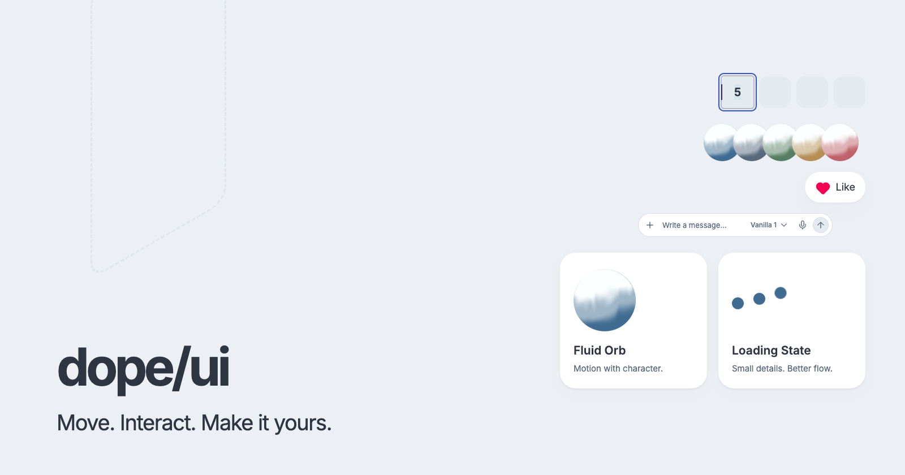

<div align="center">

[Website](https://ui.0xdope.com) · [Components](https://ui.0xdope.com/library) · [Registry](https://ui.0xdope.com/r/registry.json)

</div>

dope/uiは、アニメーションやインタラクションを実際に試しながら、必要な部品を選べるUIライブラリです。React・TypeScript・Tailwind CSS v4を使い、ボタン、ナビゲーション、ローディング、テキスト演出、AIインターフェースなどを収録しています。

shadcn CLIで編集可能なソースをプロジェクトへ取り込めます。サイトからコードをコピーして使うこともできます。

## 特徴

- **操作できるプレビュー** — 一覧と詳細で、見た目と動きを確認できます。
- **コードを手元に** — TSX、共通CSS、必要な依存関係を取り込み、自分のプロジェクトに合わせて編集できます。
- **共通のカラーとスタイル** — FROSTのカラートークンと共通CSSで、部品を組み合わせやすくしています。
- **利用コードまで確認** — 詳細ページで導入コマンド、Reactコード、使用例を参照できます。

## クイックスタート

React 19とTailwind CSS v4を設定したプロジェクトで、shadcn CLIを初期化して部品を追加します。初期化済みの場合は、`add`から実行してください。

```sh
npx shadcn@latest init
npx shadcn@latest add https://ui.0xdope.com/r/like.json
```

導入先のグローバルCSSで、共通CSSを一度読み込みます。以下は`src/index.css`から、components aliasが`src/components`を指す場合の例です。実際の配置に合わせてパスを変更してください。

```css
@import "./components/dope-ui/foundation.css";
```

`foundation.css`はTailwind本体とshadow-pluginも読み込みます。既存の`@import "tailwindcss"`との重複を避け、Tailwind v4用のViteまたはPostCSS設定を用意してください。共通CSSのトークンとbaseスタイルはページ全体に適用されるため、既存のテーマに合わせて調整できます。

```tsx
import Like from "@/components/like";

export default function Example() {
  return <Like />;
}
```

インポート先は`components.json`のalias設定に従います。Next.jsなどで使う場合は、コンポーネントの`"use client"`を保持してください。

部品を選ぶには[コンポーネント一覧](https://ui.0xdope.com/library)を開き、詳細ページの導入コマンドを使います。

### 名前空間で追加する

導入先の`components.json`へ、既存の設定を残したまま`registries`を追加すると、短い名前で部品を指定できます。

```json
{
  "registries": {
    "@dope-ui": "https://ui.0xdope.com/r/{name}.json"
  }
}
```

```sh
npx shadcn@latest add @dope-ui/like
```

## ローカル開発

Node.jsとnpm、`make`が使える環境で実行します。

```sh
git clone https://github.com/ackkerman/DopeUI.git
cd DopeUI
npm ci
make dev
```

| コマンド           | 内容                                         |
| ------------------ | -------------------------------------------- |
| `make dev`         | 開発サーバーを起動                           |
| `make check`       | lint・整形・型・テスト・ビルド・配布物を検証 |
| `make format`      | コードを整形                                 |
| `make registry`    | コピー用TSXとshadcn Registryを生成           |
| `make pages-build` | Cloudflare Pages向けの静的サイトをビルド     |

コンポーネントの実装は`src/library/components`、共通部品は`src/library/primitives`、配布定義は`src/library/registry.ts`にあります。実装や配布定義を変更したら、`make registry`で配布物を更新してください。開発サーバー起動時とビルド時にも生成します。

## コントリビューション

不具合報告や改善提案は[Issues](https://github.com/ackkerman/DopeUI/issues)へ。Pull Requestでは、変更の目的と確認方法を添えてください。
